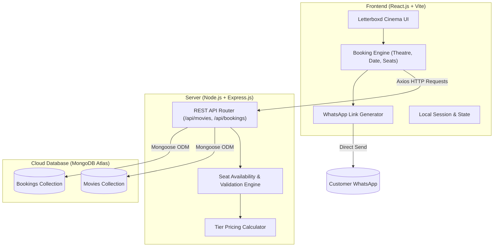
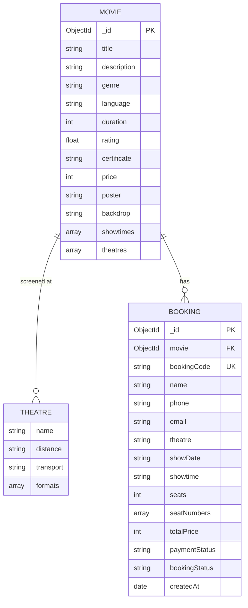

# 📑 iMovies — Full Stack MERN Capstone Project Report
**Project Name:** iMovies – Movie Ticket Booking Made Simple  
**Track:** Full Stack Development (MERN Stack)  
**Platform:** SkillWallet / SmartBridge (MongoDB & nasscom FutureSkills Prime)  
**Student Name:** Krish  
**GitHub Repository:** [https://github.com/Kr1sh8/IMovies-movie-ticket-booking](https://github.com/Kr1sh8/IMovies-movie-ticket-booking)  

---

## 1. Executive Summary & Problem Statement
The modern cinema booking experience requires speed, clear visual seating layouts, transparent pricing, and instant ticket confirmations. Existing systems are often cluttered with advertisements and lack real-time transport accessibility indicators. 

**iMovies** is a full-stack web application designed with a sleek **Letterboxd-inspired dark aesthetic**. It allows moviegoers to discover trending blockbusters, select nearby multiplexes with commute estimates (e.g. 5 min by 🛺 E-Rickshaw), choose specific tier-based seats (VIP Recliners vs. Prime Extra Legroom vs. Classic), and receive a verified digital boarding pass with **one-click instant delivery to WhatsApp**.

---

## 2. Technical Architecture

---

## 3. Entity-Relationship (ER) Diagram

---

## 4. Key Modules & Features

1. **Letterboxd-Inspired UI:**
   - Dark cinema mode (`#0b0e14`) with custom neon-green and amber color system.
   - Dynamic Hero Spotlight Banner with high-resolution backdrops, certification badges, and IMDb star ratings.
   - Real-time movie search by title and genre.
   - Dynamic city selection (`Delhi NCR`, `Mumbai`, `Bengaluru`).

2. **Multiplex & Proximity Selection:**
   - Multiple theatre listings with commute estimation: `5 min by 🛺 E-Rickshaw`, `10 min by 🚇 Metro Line 3`.
   - Screening technology badges: **IMAX 3D**, **Dolby Atmos 7.1**, **4DX**, **Laser Ultra**.

3. **Visual Multiplex Seating Matrix:**
   - Realistic curved screen top canvas (`ALL EYES THIS WAY`).
   - Categorized seating tiers:
     - 🛋️ **Royal Recliner (Row A, ₹400)** — Luxury plush leather recliners.
     - 🌟 **Prime / Best Seller (Rows B & C, ₹280)** — Highlighted in gold with extra legroom & center sweet spot.
     - 🎟️ **Classic Standard (Rows D, E, F, ₹180)** — Budget comfort.
   - Instant calculation of total price and seat limit enforcement (max 8 seats).

4. **Digital Pass & WhatsApp Automation:**
   - Unique alphanumeric booking reference ID (`IMV-XXXXX`).
   - Digital cinema boarding pass card with perforated edges and dynamic QR code.
   - Direct WhatsApp integration sending formatted booking receipts to user's registered phone number.

5. **My Bookings Dashboard:**
   - Saved tickets history with instant retrieval and re-sharing options.

---

## 5. Technology Stack Summary

| Layer | Technologies Used |
| :--- | :--- |
| **Frontend** | React 19, Vite, Axios, Modern Responsive CSS, HTML5, JavaScript ES6+ |
| **Backend** | Node.js, Express.js (RESTful architecture), CORS, Dotenv |
| **Database** | MongoDB Atlas (Cloud NoSQL), Mongoose ODM |
| **External APIs** | QR Server API (Dynamic QR codes), WhatsApp Web API |
| **Tools & Platforms** | Git, GitHub, VS Code, Postman |

---

## 6. Testing & Quality Assurance
- **Seat Conflict Prevention:** Tested race conditions to ensure already-booked seats cannot be double-booked for the same showtime and date.
- **Form Validations:** Verified mobile number format (+91 10-digit validation), email regex, and seat limits.
- **Cross-Browser Responsiveness:** Tested layouts across mobile viewports, tablets, and desktop displays.
